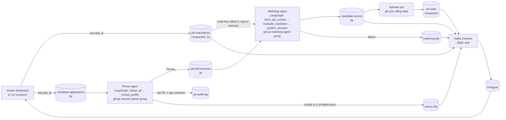

# Event-Driven Agentic Recruiting Pipeline

A multi-agent recruiting pipeline built on Apache Kafka. A resume enters as an event, one LangGraph agent redacts PII and extracts a profile, a second agent joins that profile with the current job requisition and scores the candidate, and Kafka Connect lands the results in Postgres. Everything runs locally with Docker.

It is a portfolio project. The goal is to show these ideas working together, with the trade-offs written down:

- Kafka in KRaft mode, schema contracts enforced by Schema Registry, compacted topics, DLQs, manual offset commits
- A stream-table join built by hand (job table in memory, resume stream)
- LLM agents as decoupled consumers, with guardrails and an offline evaluation harness
- Kafka Connect JDBC sink and a pure-Python bytewax stateful job
- Metrics, alerts and structured logs. `PROD:` comments across the code mark what to change for production.

## Architecture



| Service | Code | Consumes | Produces |
|---|---|---|---|
| Producer / seed | `services/producer` | none | `job-requisitions`, `candidate-applications` |
| Parser agent | `services/parser` | `candidate-applications` | `parsed-resumes`, `pii-audit-log`, `parser-dlq` |
| Matching agent | `services/matching` | `parsed-resumes`, `job-requisitions` | `candidate-scores`, `matching-dlq` |
| Analytics (bytewax) | `services/analytics` | `candidate-scores` | `job-stats` |
| Sink | `infra/connect` (Kafka Connect, no custom code) | scores, DLQs, job-stats, jobs | Postgres |
| Dashboard | `services/dashboard`, `app.py` | Postgres (read-only) | events via the producer |

Services share only the `recruiting.common` library and the Avro contracts. They never call each other.

## Quick start

Requirements: Docker, [uv](https://docs.astral.sh/uv/). Python 3.11 is installed by uv.

```bash
cp .env.example .env     # LLM_PROVIDER=mock works with no API key
make up                  # = docker compose up -d --build   (waits for init containers)
make install

make seed                # 3 jobs, 10 resumes (1 corrupted), plus 3 edits of JOB-1001 to demo compaction
make parser              # terminal 1
make matching            # terminal 2
make analytics           # terminal 3
make dashboard           # terminal 4  -> http://localhost:7860
```

| URL | What |
|---|---|
| http://localhost:8080 | Kafka UI: topics, messages, schemas, consumer lag, Connect |
| http://localhost:7860 | Recruiter dashboard |
| http://localhost:8081 | Schema Registry |
| http://localhost:8083 | Kafka Connect REST |
| http://localhost:9091 / :3000 | Prometheus / Grafana (`make observability`) |

To run all Python services as containers instead of host processes: `make apps`.

### Using a real LLM

Set in `.env`:

```
LLM_PROVIDER=openai
OPENAI_API_KEY=sk-...
OPENAI_MODEL=gpt-4o-mini
```

`LLM_PROVIDER=mock` is a deterministic rule-based stand-in (keyword skills, regex years, weighted score). It keeps the demo, tests and CI free and offline, and it is the baseline the eval harness compares against.

**Status:** the OpenAI path is covered by offline wiring tests (the schema binds as a tool, missing key fails fast). It has not been run against the live API in this repo's test runs, so run `make eval` with your key before trusting the numbers.

## Topics

Source of truth: [`infra/topics.json`](infra/topics.json). The `init` container creates them and registers the schemas (`auto.create.topics.enable=false`, so typos fail loudly).

| Topic | Partitions | Key | Cleanup | Purpose |
|---|---|---|---|---|
| `job-requisitions` | 2 | `job_id` | compact | Latest definition per job. Closing a job publishes `status=CLOSED`, not a tombstone |
| `candidate-applications` | 3 | `job_id` | delete | Raw applications (contain PII) |
| `parsed-resumes` | 3 | `job_id` | delete | PII-free profiles |
| `parser-dlq` | 1 | `application_id` | delete | Unparseable or failed resumes |
| `candidate-scores` | 3 | `job_id` | delete | Final decisions |
| `pii-audit-log` | 1 | `application_id` | delete (1 day) | Added: raw PII found and removed |
| `matching-dlq` | 1 | `application_id` | delete | Added: matching failures |
| `job-stats` | 2 | `job_id` | compact | Added: bytewax output |
| `connect-dlq` | 1 | none | delete | Added: records Kafka Connect could not write |

Schemas are in [`schemas/`](schemas). Each has a pydantic mirror in `common/models.py`, and `tests/test_contracts.py` fails if the two drift apart. Compatibility is `BACKWARD` and new fields carry defaults. Producers use `auto.register.schemas=False`, so only the init step can change a contract.

## Design decisions and trade-offs

**Delivery semantics: at-least-once, with idempotent sinks.** Consumers use `enable.auto.commit=False` and commit only after the output (result or DLQ record) is acknowledged by the broker (`acks=all`, idempotent producer). If a produce fails, the offset is not committed and the message is rewound and retried. A crash between produce and commit re-delivers the message and creates a duplicate downstream. This is accepted because every sink is idempotent: Postgres upserts on `application_id`, and the bytewax aggregate keeps the latest score per application. Exactly-once (transactions with `send_offsets_to_transaction`) would remove the duplicates at the cost of throughput and more moving parts, and the downstream effects (an LLM call, an HTTP call) are not transactional anyway.

**Partitioning by `job_id`.** All applications and scores for a job go to one partition, so they are ordered per job. The cost is skew: one popular job becomes a hot partition. The alternative is keying by `application_id` and giving up per-job ordering. `parsed-resumes` and `candidate-applications` both have 3 partitions so the key mapping stays aligned.

**Stream-table join without a stream framework.** `matching/state_store.py` reads the compacted `job-requisitions` topic from offset 0 with `assign()` (no group offsets, so each restart rebuilds the full table) and keeps following it, so edits and `CLOSED` apply live. The agent does not start consuming resumes until the table has caught up to the end of every partition. Known limits: the table is held fully in memory in every instance, and the two topics are not synchronised. A resume can arrive before its job, so the agent waits up to 5 seconds and then sends the record to `matching-dlq` as `JOB_NOT_FOUND`. A resume scored just before a job edit uses the old job version. Kafka Streams or Flink would give you co-partitioned, RocksDB-backed tables and event-time semantics.

**Closing a job.** A tombstone would delete the key on compaction, and a consumer could not tell a closed job from a job it had never seen. A `CLOSED` record keeps the fact in the log. Resumes for a closed job are discarded and counted in a metric, with no output and the offset committed.

**PII handling.** Redaction is deterministic code (regex plus the known name and email from the event), and it runs before any text reaches the LLM. Rules are auditable and need no third party to see PII. The weakness is recall on free-text names and addresses. The LLM output is scrubbed with the same rules as defence in depth, and the eval harness counts leaks. `anonymized_id` is a SHA-256 of the email, which can be reversed with a dictionary of emails, so use an HMAC with a secret key in production. Raw PII goes only to `pii-audit-log` (1 day retention). `candidate-applications` and `parser-dlq` also contain PII, as the schemas say.

**Agents are graphs, errors are state.** Nodes record failures in graph state instead of raising, so the Kafka layer can route to a DLQ and still commit, and a bad record never blocks a partition. Delivery errors are the exception: they propagate so the offset stays uncommitted. LLM calls get 2 attempts, then the record goes to the DLQ with error type, message, traceback, and the source topic, partition and offset.

**Code owns policy, the model proposes.** The recommendation label must follow the score thresholds (85 and 45). If the model returns a label that contradicts its own score, the code overrides it. The prompt also tells the model to ignore protected attributes, and the model only ever sees the anonymised profile. Prompt text is versioned (`parser-v1`, `matching-v1`) and every record carries `model` and `prompt_version`.

**Kafka Connect for the sink.** Four JDBC sink connectors (upsert mode, `auto.create=false` with the DDL in `infra/postgres/init.sql`) replace a hand-written consumer. This is less code and gets offset management, scaling and error tolerance from Connect. The cost is a JVM service and a connector plugin to install and pin. Connect errors go to `connect-dlq` instead of stopping the connector.

**bytewax for the one genuinely stateful job.** The agents are per-message LLM calls, where a dataflow engine adds little. Rolling per-job statistics are a natural keyed state problem, so that is where bytewax runs. The pure aggregation function is separate from the Kafka wiring and unit-tested. The job rebuilds its state by reading `candidate-scores` from the beginning, which is fine for this volume. For more data, enable bytewax recovery.

**Single-node settings are demo settings.** Replication factor 1, plaintext listeners, `segment.ms=60s` and a low dirty ratio on the compacted topics (so compaction is visible in a demo), and credentials in compose. Each has a `PROD:` note beside it.

## Evaluation

```bash
make eval            # offline, no Kafka needed, uses LLM_PROVIDER from .env
make eval JUDGE=1    # adds LLM-as-judge groundedness (needs LLM_PROVIDER=openai)
```

`recruiting/eval` runs the same LangGraph graphs the services run over 13 hand-labelled cases: the 10 seed resumes, a prompt-injection resume, a resume with PII scattered in prose, and a too-short resume. Stages are scored separately so a regression can be traced to one agent:

| Stage | Metrics |
|---|---|
| parser | skill precision / recall / F1, years-of-experience error, PII leaks (must be 0), correct DLQ routing |
| matching, on gold profiles | recommendation accuracy, and within one level |
| end to end | recommendation accuracy against the human label |
| safety | the prompt-injection resume must not become `STRONG_HIRE` |

The command exits 1 when a gate in `THRESHOLDS` is missed, so it can block a prompt or model change in CI. Reports are written to `eval/reports/`.

The mock baseline passes its gates and shows its limits. It reads "No production Kafka experience" as Kafka experience (Emily Carter scores `STRONG_HIRE`, label `INTERVIEW`), and it takes the skills listed in the injection text. Those two cases are where a real model should beat the baseline, so check them first when you run with your key. 13 cases is too small to measure a model. It is enough to catch a broken prompt or a PII regression.

## Observability

- **Logs:** one JSON line per event with `service`, `application_id` and `job_id`.
- **Metrics:** each service exposes Prometheus metrics (parser `:8001`, matching `:8002`, analytics `:8003`): messages consumed and produced, DLQ routing by reason, discards, LLM calls by outcome, LLM latency, processing time.
- **Lag and offsets:** `kafka-exporter`. Grafana dashboard `Recruiting Pipeline` is provisioned.
- **Alerts** (`infra/observability/alerts.yml`): any new DLQ message, consumer lag above 50 for 2 minutes, LLM error rate above 20%, LLM p95 latency above 10 seconds. No Alertmanager is wired up.
- **Correlation:** the `correlation-id` Kafka header carries `application_id`.

Start it with `make observability`. It scrapes the services on the host, so start them first, or use `make apps`.

## Testing

```bash
make test           # 47 unit and contract tests, no Docker needed
make integration    # starts the real parser and matching services and follows a resume through Kafka and Connect to Postgres
make lint
```

Unit tests cover PII redaction, both LangGraph graphs (retry, DLQ, closed job, job update, guardrail), the bytewax aggregate, schema/model/topic/connector consistency, and the OpenAI wiring.

## Useful commands

```bash
make inspect TOPIC=parsed-resumes          # decode Avro messages with partition and key
uv run python scripts/scan_pii_leaks.py parsed-resumes
make lag                                   # consumer group lag
curl localhost:8083/connectors?expand=status | python3 -m json.tool
make reset                                 # stop and delete all data
```

**Watch compaction:** `make seed` publishes 3 extra edits of `JOB-1001`. After the 60 second segment rolls and a later record arrives, `make inspect TOPIC=job-requisitions` shows only the latest version per key.

## Changes from the PRD

- Added topics `pii-audit-log`, `matching-dlq`, `job-stats`, `connect-dlq`.
- The `pii-group` redactor from the diagram is folded into the parser agent, as the PRD note suggested.
- Sink is Postgres via Kafka Connect JDBC (SQLite cannot be shared safely between containers and host processes).
- The LLM structured output is a smaller `ExtractedProfile`. IDs, the email hash and lineage fields are added by code, so the model cannot invent them.
- `ParsedResume` and `CandidateScore` also carry `model`, `prompt_version` and a timestamp. `JobRequisition` carries `description` and `updated_at`.
- Added: eval harness, Prometheus and Grafana, bytewax analytics, mock LLM provider.

## Known limitations

- The matching agent's job table is in memory per instance. It is not partitioned across instances.
- Not verified against a live OpenAI model (see above).
- `parser-dlq` and `candidate-applications` hold PII in plaintext, and the topics are unauthenticated.
- No DLQ replay tool.
- Schema Registry keys are plain strings, so only values are under a schema.
- The dashboard has no authentication.
